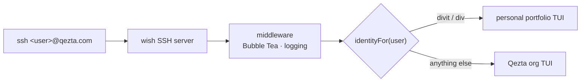

<div id="top">
    <div align="center">
        
        <h1 align='center'>ssh</h1>
        <strong>ssh divit@qezta.com: SSH terminal portfolio mirroring divit.qezta.com, built on wish + Bubble Tea</strong>
    </div>

</div>

---

<div align='center'>
    <a href="https://github.com/Qezta/ssh/stargazers">
        
    </a>
    <a href="https://github.com/Qezta/ssh/">
        
    </a>
    <a href="https://github.com/Qezta/ssh/blob/main/LICENSE">
        
    </a>
    <a href="https://github.com/nixos/nixpkgs">
        
    </a>
    
</div>

---

## Contents

- [Overview](#overview)
- [How it works](#how-it-works)
- [Stack](#stack)
- [Commands](#commands)
- [Development](#development)
- [Nix](#nix)
- [Security](#security)
- [License](#license)

---

## Overview

**`ssh divit@qezta.com`** — a real SSH server that drops you straight into a
terminal portfolio, no real shell access involved.

This mirrors the fake browser terminal on
[divit.qezta.com](https://divit.qezta.com) (see
[`Terminal.svelte`](https://github.com/Qezta/divit/blob/main/src/lib/components/Terminal.svelte)
and
[`terminal-commands.ts`](https://github.com/Qezta/divit/blob/main/src/lib/data/terminal-commands.ts)
in [`Qezta/divit`](https://github.com/Qezta/divit)), but backed by a genuine
SSH connection instead of a JS widget. The server never grants a real shell,
only a sandboxed [Bubble Tea](https://github.com/charmbracelet/bubbletea)
TUI — but which persona you land in depends on the username you connect as:

```sh
ssh divit@qezta.com   # Divit's personal portfolio
ssh qezta@qezta.com   # generic Qezta org landing (any other username too)
```

There's a single SSH listener on `qezta.com`, so identity is chosen by
username rather than running a separate server per persona — see
`identityFor` in [`internal/tui/commands.go`](./internal/tui/commands.go).
Only `divit`/`div` get the personal identity; every other username (`hi`,
`qezta`, `guest`, ...) falls back to the org identity.

## How it works



No shell is ever started: every session is a Bubble Tea program.

## Stack

- [`wish`](https://github.com/charmbracelet/wish) — SSH server middleware
- [`bubbletea`](https://github.com/charmbracelet/bubbletea) — TUI framework
- [`lipgloss`](https://github.com/charmbracelet/lipgloss) — styling

## Commands

Shared: `clear`, `nix-build`, `cowsay <text>`.

`divit`/`div` (personal): `help`, `about`, `projects
[--ml|--infrastructure|--functional]`, `skills [--expert]`, `contact`,
`experience`, `resume`.

Anything else (org): `help`, `about`, `repos`, `contact`.

## Development

```sh
go run .                        # serves on :23234 by default
ssh -p 23234 divit@localhost    # personal identity
ssh -p 23234 qezta@localhost    # org identity
```

| Variable | Default | Purpose |
| ------------------- | ---------------------- | --------------------------------------- |
| `SSH_HOST` | `0.0.0.0` | Bind address |
| `SSH_PORT` | `23234` | Bind port (proxy/forward 22 to this in prod) |
| `SSH_HOST_KEY_PATH` | `.ssh/qezta_ed25519` | Where the server's host key is generated/read |

```sh
go build ./...   # build
go vet ./...     # vet
gofmt -l .       # format check
```

## Nix

```sh
nix develop      # devshell with go, gopls, golangci-lint
nix build        # builds the server as `result/bin/ssh` (flake/packages.nix)
```

`packages.default` is what `infra`'s `nixosModules.ssh-portfolio` module
expects as `services.qezta.sshPortfolio.package` when deploying this to a
host — see that module for the systemd unit wiring.

## Security

This server intentionally accepts any username with any key or password —
see [SECURITY.md](./SECURITY.md) for what's in and out of scope.

## License

MIT — see [LICENSE](./LICENSE).

<div align="right">

[![][back-to-top]](#top)

</div>

[back-to-top]: https://img.shields.io/badge/-BACK_TO_TOP-151515?style=flat-square&color=purple
